# ChecadorDesktop

Aplicación de escritorio Windows Forms en .NET 8 con enfoque Offline-First para registro de asistencia, alertas bloqueantes de jornada y operación en segundo plano mediante bandeja del sistema.

## Objetivo

ChecadorDesktop permite registrar marcajes de asistencia con evidencia fotográfica local, incluso sin conectividad hacia la API central. Los registros se almacenan en SQLite y se sincronizan automáticamente cuando vuelve la conexión.

## Características principales

- Flujo de 4 marcajes secuenciales por jornada:
  - 1: Entrada
  - 2: Salida a comer
  - 3: Entrada de comer
  - 4: Salida final
- Ventana anti-duplicados de 5 minutos entre marcajes.
- Captura de evidencia fotográfica en JPEG (o estampa digital de respaldo).
- Persistencia local inmediata en SQLite (garantía Offline-First).
- Reintento y sincronización en segundo plano.
- Vinculación y desvinculación de estación protegidas por credenciales administrativas.
- Alertas bloqueantes por horario oficial de jornada (Entrada, Salida a comer, Regreso de comida y Salida).
- Reglas de pospuesto legal (solo tipos 2 y 3, 10 minutos).
- Modo segundo plano con System Tray (NotifyIcon), manteniendo monitoreo activo aunque la ventana principal esté oculta.

## Stack técnico

- .NET 8 (net8.0-windows)
- Windows Forms
- SQLite local (System.Data.SQLite.Core)
- HTTP + JSON (HttpClient + Newtonsoft.Json)
- Configuración por appsettings.json
- Captura/estampa de imagen JPEG con System.Drawing

## Dependencias NuGet

- System.Data.SQLite.Core 1.0.118.0
- Newtonsoft.Json 13.0.3
- FlashCap 1.8.0
- Microsoft.Extensions.Configuration.Json 8.0.0
- System.Drawing.Common 8.0.0

## Estructura del proyecto

- Program.cs: Punto de entrada de la aplicación.
- appsettings.json: Configuración de API y sincronización.
- Models/AppModels.cs: Entidades locales y DTOs de comunicación API.
- Data/SQLiteRepository.cs: Repositorio SQLite y operaciones locales.
- Services/ApiClientService.cs: Cliente REST con X-Api-Key.
- Services/WebcamService.cs: Captura/estampa de evidencia JPEG.
- Services/SyncManager.cs: Sincronización en segundo plano.
- Services/AlertScheduler.cs: Programador de alertas por horarios oficiales y secuencia de marcajes.
- Forms/AdminLoginForm.cs: Autorización administrativa.
- Forms/BindingForm.cs: Vinculación de estación al trabajador.
- Forms/InitialPinSetupForm.cs: Sincronización única de horarios en modo autónomo si la caché está vacía.
- Forms/AlertNotificationForm.cs: Alerta modal bloqueante con captura y registro inmediato en monitor principal.
- Forms/OverlayBackgroundForm.cs: Pantalla cortina de bloqueo visual al 100% en monitores secundarios.
- Forms/MainForm.cs: Flujo principal de autenticación, monitoreo y marcaje.
- ChecadorGuard/Program.cs: Centinela de supervisión continua (Watchdog Capa 2) para reanudación de la aplicación.

## Flujo funcional completo

1. **Inicio de aplicación y Watchdog:**
   - Inicio automático con Windows (mediante Tarea Programada en Logon / Capa 1).
   - Verificación y lanzamiento de `ChecadorGuard.exe` (centinela en background / Capa 2).
   - Arranque de `SyncManager` en segundo plano para monitoreo de conectividad, envío de Heartbeat y sincronización.
2. **Validación Offline-First de vínculo local:**
   - Comprobación en SQLite (`ESTACION_VINCULO_LOCAL`) por estación (`Environment.MachineName`).
   - El vínculo es **permanente** y solo se inactiva por desvinculación explícita (no tiene caducidad de 30 días en el cliente).
3. **Si no existe vínculo local o está inactivo:**
   - Se muestra `BindingForm`.
   - Se solicita ID de trabajador y su PIN por única ocasión para descargar y almacenar sus horarios oficiales en `WORKER_CACHE`.
   - Se exige autorización de administrador (`AdminLoginForm`).
   - Se registra el vínculo en la API y se guarda localmente en SQLite.
4. **Si existe vínculo local activo:**
   - Se precarga `IDTrabajador` en `MainForm`.
   - Se evalúa la bandera `"NeedPin"` en `appsettings.json`.
5. **Modo Autónomo (`NeedPin = false` - Cero Fricción):**
   - Si `WORKER_CACHE` no tiene horarios (ej. migración de versión), se muestra `InitialPinSetupForm` por única vez para sincronizar horarios desde la API.
   - Con los horarios en caché, `AlertScheduler` se activa **inmediatamente al arrancar**.
   - `MainForm` se minimiza automáticamente a la bandeja del sistema (System Tray) sin requerir interacción matutina del usuario.
6. **Modo Tradicional (`NeedPin = true`):**
   - Se solicita PIN al inicio de la jornada en `MainForm`.
   - Valida identidad contra la API (con fallback a caché SQLite) y activa `AlertScheduler` tras autenticar.
   - En este modo, el PIN solo se pide para la Entrada (Tipo 1); las checadas 2, 3 y 4 reutilizan la sesión local activa.
7. **Detección de horarios y alertas multimonitor:**
   - `AlertScheduler` evalúa los 4 horarios oficiales en segundo plano cada 30 segundos.
   - Al alcanzarse la hora oficial del siguiente tipo de marcaje (1..4):
     - Se identifican todos los monitores activos (`Screen.AllScreens`).
     - Se despliegan pantallas cortina oscuras al 100% (`OverlayBackgroundForm`) en todos los monitores secundarios.
     - Se despliega la ventana invasiva modal (`AlertNotificationForm`) al 60% en el monitor principal.
8. **Marcaje a "Un Solo Clic":**
   - En tipos 2 y 3 (comida), el colaborador puede posponer la alerta si está habilitado en configuración (`Posponer = true`).
   - El colaborador presiona **"REGISTRAR ASISTENCIA AHORA"**.
   - Se valida la ventana mínima de 5 minutos entre registros consecutivos.
   - Se captura evidencia fotográfica JPEG mediante OpenCV (con fallback de proveedor y estampa digital si aplica).
   - Se guarda de inmediato en SQLite (`COLA_REGISTROS`) con `EstadoSync = 0` (Garantía Offline-First).
   - En modo autónomo se envía `Pin = 0`; en modo NeedPin se envía el PIN autenticado.
   - Se intenta envío online inmediato (`POST /api/asistencia/marcaje/online`).
   - Los avisos de confirmación o advertencias de negocio (`exito = 2`) se muestran en primer plano (`TopMost` con propietario).
   - Se cierran simultáneamente la alerta principal y todas las pantallas cortinas secundarias.
9. **Sincronización y tareas en segundo plano:**
   - `SyncManager` emite un latido (`POST /api/asistencia/heartbeat`) cada 60 segundos hacia el servidor.
   - Si hay conectividad, transmite lotes de registros pendientes hacia `POST /api/asistencia/marcaje/offline`.

- Una vez por día (configurable), refresca horarios del trabajador desde `GET /api/workers/{idTrabajador}/schedule` y actualiza `WORKER_CACHE` sin solicitar PIN.
- Purga automática diaria de registros sincronizados con antigüedad mayor a 30 días.

10. **Cierre seguro por administrador:**
    - Al cerrar desde la bandeja del sistema, se exige autorización de administrador (`AdminLoginForm`).
    - Al autorizarse, la aplicación detiene coordinadamente el proceso `ChecadorGuard.exe` para permitir el mantenimiento sin relanzamientos en bucle.
11. **Desvinculación:**
    - Se elimina el vínculo en el servidor y se desactiva localmente en SQLite (`Activo = 0`).

## Especificación técnica cerrada: PIN solo en Entrada (Modo NeedPin=true)

### Objetivo normativo

Definir de manera cerrada la regla de negocio para autenticación y marcaje cuando `NeedPin = true`:

- El PIN se captura y valida una sola vez al inicio de jornada (TipoRegistro 1: Entrada).
- Los marcajes TipoRegistro 2, 3 y 4 no solicitan PIN al usuario.
- La identidad para tipos 2/3/4 se resuelve con sesión laboral activa local.

### Alcance

- Aplica a marcaje manual en MainForm.
- Aplica a marcaje desde alertas bloqueantes (AlertNotificationForm).
- Aplica en modo online y offline-first.
- Aplica a sincronización diferida de registros pendientes.

### Fuera de alcance

- Cambio de credenciales administrativas.
- Rediseño de tablas históricas fuera de los campos necesarios de sesión.
- Cambios de política de horarios o secuencia 1->2->3->4.

### Definiciones operativas

- Sesión laboral activa: estado local creado tras validar Entrada (Tipo 1) y vigente hasta Salida final (Tipo 4) o expiración por inactividad.
- Reinicio a mitad de jornada: cierre y reapertura de la app después de registrar Tipo 1 y antes de Tipo 4.
- Reautenticación: nueva captura de PIN en MainForm para restablecer sesión laboral activa.

### Reglas funcionales cerradas

1. El PIN es obligatorio solo para registrar TipoRegistro 1.
2. Tipos 2, 3 y 4 se permiten sin captura de PIN visible en UI.
3. Para 2/3/4 debe existir sesión laboral activa local del trabajador vinculado.
4. Si no existe sesión activa al intentar 2/3/4, se exige reautenticación por PIN.
5. La sesión laboral activa debe persistir localmente para tolerar reinicio de app.
6. Tipo 4 cierra explícitamente la sesión laboral activa.
7. Si pasan 12 horas desde la última autenticación de Tipo 1, la sesión expira y se exige PIN.
8. Las reglas de anti-duplicado de 5 minutos y secuencia de marcajes no cambian.
9. El flujo offline-first no cambia: primero guardar local, luego sincronizar.
10. Si el contrato API sigue requiriendo Pin en todos los tipos, para 2/3/4 se envía el PIN de sesión, sin mostrarlo ni solicitarlo otra vez.

### Flujo operativo cerrado

1. Trabajador vinculado abre app.
2. MainForm solicita PIN para Entrada.
3. Se valida identidad (API y fallback caché local).
4. Se registra Tipo 1 y se crea sesión laboral activa local.
5. Scheduler y alertas operan normalmente.
6. En Tipo 2/3/4, el sistema usa sesión activa y no pide PIN.
7. Cada marcaje conserva captura de evidencia y política de cámara configurada.
8. Cada marcaje persiste en COLA_REGISTROS con EstadoSync correspondiente.
9. Si la app reinicia a mitad de jornada, intenta recuperar sesión activa local.
10. Si recuperación es válida, continúa 2/3/4 sin PIN.
11. Si recuperación no es válida o está expirada, solicita PIN para reautenticar.
12. En Tipo 4, registra salida final y cierra sesión laboral activa.

### Criterios de aceptación

CA-01: En jornada nueva, Tipo 1 exige captura de PIN y no permite continuar sin él.

CA-02: Tras registrar Tipo 1 exitoso, la UI no solicita PIN para Tipo 2/3/4.

CA-03: En intento de Tipo 2/3/4 sin sesión activa, el sistema bloquea marcaje y solicita reautenticación.

CA-04: Después de reautenticación válida, el marcaje 2/3/4 continúa sin solicitar PIN adicional.

CA-05: Al reiniciar app a mitad de jornada con sesión válida persistida, 2/3/4 se permiten sin PIN.

CA-06: Al reiniciar app sin sesión válida persistida, 2/3/4 requieren PIN antes de registrar.

CA-07: Tipo 4 cierra sesión laboral activa y obliga PIN en la siguiente Entrada del día siguiente.

CA-08: La regla de ventana mínima de 5 minutos se mantiene intacta para todos los tipos.

CA-09: En modo sin red, el flujo guarda localmente 1/2/3/4 sin pérdida de datos y respeta la regla de PIN solo en Tipo 1.

CA-10: Al restaurar red, SyncManager sincroniza pendientes sin duplicar registros por cambio de regla de PIN.

CA-11: En auditoría local queda trazabilidad de sesión creada, sesión recuperada, sesión expirada y sesión cerrada.

CA-12: Si API requiere campo Pin en tipos 2/3/4, el payload se completa con PIN de sesión sin interacción del usuario.

### Casos QA obligatorios

| ID QA     | Escenario                        | Precondición                             | Pasos                                                  | Resultado esperado                                   |
| --------- | -------------------------------- | ---------------------------------------- | ------------------------------------------------------ | ---------------------------------------------------- |
| QA-PIN-01 | Entrada con PIN                  | Jornada sin marcajes                     | Registrar Tipo 1 con PIN válido                        | Entrada exitosa y sesión activa creada               |
| QA-PIN-02 | Entrada sin PIN                  | Jornada sin marcajes                     | Intentar Tipo 1 sin PIN                                | Bloqueo con mensaje de PIN obligatorio               |
| QA-PIN-03 | Salida a comer sin PIN           | Tipo 1 registrado, sesión activa         | Registrar Tipo 2 desde MainForm                        | Registro exitoso sin captura de PIN                  |
| QA-PIN-04 | Entrada comida sin PIN           | Tipo 2 registrado, sesión activa         | Registrar Tipo 3 desde MainForm                        | Registro exitoso sin captura de PIN                  |
| QA-PIN-05 | Salida final sin PIN             | Tipo 3 registrado, sesión activa         | Registrar Tipo 4 desde MainForm                        | Registro exitoso sin captura de PIN y sesión cerrada |
| QA-PIN-06 | Alerta tipo 2 sin PIN            | Sesión activa y horario tipo 2 alcanzado | Registrar desde alerta                                 | Registro exitoso sin solicitar PIN                   |
| QA-PIN-07 | Reinicio con recuperación válida | Tipo 1 registrado, sesión persistida     | Cerrar app, abrir app, registrar Tipo 2                | Permite Tipo 2 sin PIN                               |
| QA-PIN-08 | Reinicio sin recuperación válida | Tipo 1 registrado, sesión no disponible  | Cerrar app, limpiar sesión, abrir app, intentar Tipo 2 | Solicita PIN para reautenticar                       |
| QA-PIN-09 | Sesión expirada                  | Sesión activa con antigüedad > 12h       | Intentar Tipo 2 o 3                                    | Bloquea y solicita PIN                               |
| QA-PIN-10 | Offline en Tipo 2/3/4            | Sesión activa y API caída                | Registrar Tipo 2/3/4                                   | Guarda en cola local sin pedir PIN                   |
| QA-PIN-11 | Sync posterior                   | Pendientes en cola por modo offline      | Restaurar API y esperar SyncManager                    | Registros sincronizados sin duplicados               |
| QA-PIN-12 | Cierre de jornada                | Tipo 4 registrado                        | Intentar nueva Entrada del siguiente ciclo             | Solicita PIN de nuevo                                |

### Matriz de decisiones: reinicio de app a mitad de jornada

| Escenario al reabrir app | Condición de sesión local                                     | Decisión operativa                          | Solicitar PIN         | Permitir tipo 2/3/4    |
| ------------------------ | ------------------------------------------------------------- | ------------------------------------------- | --------------------- | ---------------------- |
| A                        | Sesión activa válida, mismo trabajador vinculado, no expirada | Recuperar sesión automáticamente            | No                    | Sí                     |
| B                        | Sesión activa válida pero trabajador vinculado distinto       | Invalidar sesión por conflicto de identidad | Sí                    | No, hasta reautenticar |
| C                        | Sesión existe pero expirada (>12h)                            | Marcar sesión expirada                      | Sí                    | No, hasta reautenticar |
| D                        | No existe sesión local                                        | Requerir reautenticación                    | Sí                    | No, hasta reautenticar |
| E                        | Sesión corrupta/inconsistente                                 | Invalidar y registrar en bitácora           | Sí                    | No, hasta reautenticar |
| F                        | Tipo 4 ya registrado previamente                              | Jornada cerrada                             | Sí para nueva Entrada | No aplica para 2/3/4   |

### Política cerrada de recuperación de sesión

1. Recuperación automática permitida solo para escenario A.
2. Todos los demás escenarios fuerzan reautenticación con PIN.
3. Reautenticación restablece sesión activa sin alterar secuencia de tipos ya registrada.
4. Cualquier invalidación de sesión debe escribirse en BITACORA_LOCAL con motivo técnico.

### Evidencia mínima de cumplimiento

- Captura de pantalla de cada caso QA-PIN.
- Registro en BITACORA_LOCAL para eventos de sesión (create/recover/expire/close/invalidate).
- Consulta SQLite que confirme secuencia y estado de sincronización en COLA_REGISTROS.
- Evidencia de no solicitud de PIN en UI para tipos 2/3/4 bajo sesión válida.

## Diagrama de flujo integral del proceso (Mermaid)

```mermaid
flowchart TD
  %% --- ARRANQUE Y CAPAS DE PERSISTENCIA ---
  subgraph BOOT [1. Arranque del Sistema y Watchdog]
    START([Inicio de Sesión Windows]) --> SCHED_TASK[Tarea Programada / Run]
    SCHED_TASK --> LAUNCH_DESKTOP[Ejecutar ChecadorDesktop.exe]
    LAUNCH_DESKTOP --> LAUNCH_GUARD[Verificar y lanzar ChecadorGuard.exe]
    LAUNCH_GUARD --> SYNC_INIT[Iniciar SyncManager en background]
  end

  %% --- VINCULACIÓN DE ESTACIÓN ---
  subgraph VINCULACION [2. Validación de Vínculo de Estación]
    SYNC_INIT --> CHECK_VINCULO{¿Estación vinculada y activa?<br/>ESTACION_VINCULO_LOCAL}
    CHECK_VINCULO -- No --> BIND_FORM[Mostrar BindingForm]
    BIND_FORM --> BIND_DATA[Capturar ID Trabajador + PIN Trabajador]
    BIND_DATA --> BIND_AUTH[Autorización Admin: AdminLoginForm]
    BIND_AUTH --> BIND_API{¿Validación y Binding API exitoso?}
    BIND_API -- No --> BIND_FAIL[Mostrar error y cerrar app]
    BIND_API -- Sí --> BIND_SAVE[Guardar vínculo permanente y WORKER_CACHE]
    BIND_SAVE --> CHECK_MODE
    CHECK_VINCULO -- Sí --> CHECK_MODE{¿Configuración NeedPin?}
  end

  %% --- MODOS DE INICIO: AUTÓNOMO VS PIN ---
  subgraph MODO_INICIO [3. Inicialización Operativa]
    CHECK_MODE -- NeedPin = false --> CHECK_CACHE{¿Existen horarios en WORKER_CACHE?}
    CHECK_CACHE -- No --> PIN_SETUP[Mostrar InitialPinSetupForm por única vez]
    PIN_SETUP --> PIN_SYNC[Validar PIN en API y guardar WORKER_CACHE]
    PIN_SYNC --> AUTO_START
    CHECK_CACHE -- Sí --> AUTO_START[Activar AlertScheduler automáticamente]
    AUTO_START --> HIDE_TRAY[Minimizar silenciosamente a System Tray]

    CHECK_MODE -- NeedPin = true --> PIN_WAIT[MainForm espera ingreso de PIN]
    PIN_WAIT --> LOGIN_CLICK[Colaborador pulsa Continuar]
    LOGIN_CLICK --> VALIDATE_LOGIN{¿Login API / Caché exitoso?}
    VALIDATE_LOGIN -- No --> LOGIN_RETRY[Mostrar error y reintentar PIN]
    VALIDATE_LOGIN -- Sí --> MANUAL_START[Activar AlertScheduler y sesión local]
    MANUAL_START --> READY_MAIN[Panel de marcaje disponible]
  end

  %% --- MONITOR Y ALERTAS MULTIMONITOR ---
  subgraph MONITOR_ALERTAS [4. Detección de Horario y Alerta Bloqueante]
    HIDE_TRAY & READY_MAIN --> SCHED_LOOP[AlertScheduler evalúa horarios cada 30s]
    SCHED_LOOP --> TIME_REACHED{¿Hora oficial alcanzada para siguiente tipo 1..4?}
    TIME_REACHED -- No --> SCHED_LOOP
    TIME_REACHED -- Sí --> CHECK_LOCK{¿Alerta ya activa o duplicada?}
    CHECK_LOCK -- Sí --> SCHED_LOOP
    CHECK_LOCK -- No --> MULTI_SCREEN[Identificar monitores: Screen.AllScreens]
    MULTI_SCREEN --> OVERLAYS[Desplegar pantallas cortina 100% en monitores secundarios]
    OVERLAYS --> MAIN_ALERT[Desplegar AlertNotificationForm modal 60% en monitor principal]
  end

  %% --- MARCAJE Y VALIDACIÓN ---
  subgraph REGISTRO [5. Marcaje de Asistencia a Un Solo Clic]
    MAIN_ALERT --> USER_ACTION{Acción del Colaborador}
    USER_ACTION -- Tipo 2 o 3 y Pulsa Posponer --> SNOOZE[Posponer alerta 10 min]
    SNOOZE --> CLOSE_OVERLAYS
    USER_ACTION -- Pulsa REGISTRAR ASISTENCIA --> CHECK_5MIN{¿Pasaron >= 5 min desde última checada?}
    CHECK_5MIN -- No --> MSG_WARN[Aviso prioritario: esperar 5 minutos]
    CHECK_5MIN -- Sí --> CAMERA_CAP[Capturar evidencia webcam: OpenCv/FlashCap]
    CAMERA_CAP --> SAVE_LOCAL[Guardar en SQLite: COLA_REGISTROS EstadoSync=0]
    SAVE_LOCAL --> SEND_ONLINE[Intentar POST /api/asistencia/marcaje/online]
    SEND_ONLINE --> RESP_ONLINE{¿Respuesta API?}
    RESP_ONLINE -- Exito = 1 --> SYNCED[Actualizar EstadoSync = 2]
    RESP_ONLINE -- Exito = 2 Regla Negocio --> BIZ_ERR[Guardar EstadoSync = 3 y mostrar aviso]
    RESP_ONLINE -- Sin conexión / Error --> OFFLINE_KEEP[Permanece EstadoSync = 0 para SyncManager]
    SYNCED & BIZ_ERR & OFFLINE_KEEP --> MSG_SUCCESS[Mostrar confirmación en primer plano TopMost]
    MSG_SUCCESS --> CLOSE_OVERLAYS[Cerrar AlertNotificationForm y liberar cortinas secundarias]
    CLOSE_OVERLAYS --> CHECK_FINAL{¿Tipo 4 Salida Final?}
    CHECK_FINAL -- Sí y NeedPin=true --> CLOSE_SESSION[Cerrar sesión laboral local]
    CHECK_FINAL -- No o NeedPin=false --> KEEP_ACTIVE[Mantener estación lista para siguiente ciclo]
    CLOSE_SESSION & KEEP_ACTIVE --> SCHED_LOOP
  end

  %% --- TAREAS EN SEGUNDO PLANO ---
  subgraph BACKGROUND [6. SyncManager, Heartbeat y Mantenimiento]
    SYNC_INIT --> BG_LOOP[Ciclo de fondo cada 15 segundos]
    BG_LOOP --> HB_CHECK{¿Transcurrieron 60 segundos?}
    HB_CHECK -- Sí --> SEND_HB[POST /api/asistencia/heartbeat con ID y NBEquipo]
    HB_CHECK -- No --> CHECK_NET{¿API responde api/health?}
    SEND_HB --> CHECK_NET
    CHECK_NET -- No --> BG_LOOP
    CHECK_NET -- Sí --> BATCH_PENDING{¿Hay registros en COLA_REGISTROS EstadoSync 0/3?}
    BATCH_PENDING -- Sí --> SEND_BATCH[POST /api/asistencia/marcaje/offline en lote]
    SEND_BATCH --> UPDATE_QUEUE[Actualizar EstadoSync en SQLite según respuesta]
    BATCH_PENDING -- No --> PURGE_CHECK{¿Pasaron 24 horas?}
    UPDATE_QUEUE --> PURGE_CHECK
    PURGE_CHECK -- Sí --> PURGE_DB[Eliminar registros sincronizados > 30 días]
    PURGE_CHECK -- No --> BG_LOOP
    PURGE_DB --> BG_LOOP
  end

  %% --- CIERRE ADMINISTRATIVO ---
  subgraph ADMIN_EXIT [7. Cierre Autorizado]
    TRAY_MENU[Menú System Tray: Salir] --> ADMIN_AUTH[Exigir credenciales admin: AdminLoginForm]
    ADMIN_AUTH --> IS_ADMIN{¿Admin válido?}
    IS_ADMIN -- No --> CANCEL_EXIT[Permanecer activo en bandeja]
    IS_ADMIN -- Sí --> KILL_GUARD[Detener proceso ChecadorGuard]
    KILL_GUARD --> STOP_SERVICES[Detener SyncManager y AlertScheduler]
    STOP_SERVICES --> APP_EXIT([Cierre definitivo de ChecadorDesktop])
  end
```



## Descripción de formularios

### AdminLoginForm

Formulario modal para operaciones sensibles:

- Vinculación de estación.
- Desvinculación de estación.

Responsabilidad:

- Validar usuario/contraseña contra API de administrador.
- Devolver UsuarioAutenticado cuando la validación es exitosa.

### BindingForm

Formulario de vinculación inicial de estación.

Responsabilidad:

- Mostrar nombre del equipo local.
- Solicitar ID de trabajador asignado y su PIN para sincronización inicial de horarios.
- Exigir autorización administrativa.
- Llamar a CreateBindingAsync y confirmar vinculación exitosa.
- Almacenar el vínculo permanente en SQLite y cargar los horarios en WORKER_CACHE.

### InitialPinSetupForm

Formulario modal de sincronización única de horarios para modo autónomo.

Responsabilidad:

- Solicitar el PIN del colaborador vinculado por única vez si la base local no cuenta con horarios.
- Validar credenciales contra la API y descargar los 4 horarios oficiales de la jornada.
- Poblar WORKER_CACHE para permitir la operación autónoma futura sin volver a pedir PIN.

### MainForm

Formulario principal de operación diaria.

Responsabilidad:

- Gestionar el modo de inicio según la bandera NeedPin.
- En modo autónomo: inicio silencioso hacia la bandeja del sistema con activación inmediata de alertas.
- En modo tradicional: login de trabajador con fallback offline.
- Determinar tipo de marcaje siguiente (1..4).
- Mostrar preview de evidencia fotográfica.
- Registrar asistencia de forma Offline-First.
- Permitir desvinculación de equipo con autorización.
- Mostrar estado de sincronización en tiempo real.
- Integrar AlertScheduler para disparo de alertas por horario.
- Gestionar bandeja del sistema (ocultar, restaurar y salir de forma segura con apagado de ChecadorGuard).

### AlertNotificationForm

Formulario modal bloqueante de cumplimiento de jornada.

Responsabilidad:

- Renderizar ventana invasiva centrada al 60% x 60% de la pantalla principal.
- Coordinar con OverlayBackgroundForm para cubrir monitores secundarios.
- Forzar registro de asistencia o pospuesto autorizado (solo tipos 2 y 3).
- Bloquear cierre manual por usuario (Alt + F4 / UserClosing) mientras no exista cierre autorizado.
- Capturar evidencia JPEG y registrar marcaje Offline-First desde la propia alerta a un solo clic.
- Intentar sincronización online inmediata tras persistir localmente y mostrar avisos prioritarios en primer plano (TopMost).

### OverlayBackgroundForm

Formulario cortina para soporte multimonitor.

Responsabilidad:

- Cubrir el 100% de la pantalla de cada monitor secundario activo (FormBorderStyle = None, Opacity = 0.92).
- Mostrar mensaje claro orientando al colaborador a dirigirse a la pantalla principal.
- Bloquear cierres manuales por teclado y cerrarse coordinadamente al finalizar el marcaje principal.

## Programador de alertas

Componente: AlertScheduler.

Responsabilidad:

- Evaluar en segundo plano los horarios oficiales del trabajador autenticado.
- Respetar secuencia de tipos 1 -> 2 -> 3 -> 4 usando el último registro local del día.
- Aplicar ventana mínima de 5 minutos entre checadas.
- Emitir evento OnAlertaDisparada para abrir AlertNotificationForm.
- Gestionar pospuestos en memoria para tipos 2 y 3.

## Operación en segundo plano (System Tray)

- Al minimizar manualmente o cerrar con X, MainForm se oculta y la app sigue activa.
- El icono de bandeja permite:
  - Abrir Checador.
  - Salir de la aplicación.
- Mientras esté en tray, AlertScheduler y SyncManager continúan operando.

## Repositorio SQLite local

Archivo de base de datos:

- ChecadorLocal.db (en directorio de ejecución).

Tablas:

- COLA_REGISTROS:
  - Cola de marcajes locales, evidencia fotográfica y su estado de sincronización.
- WORKER_CACHE:
  - Caché local de trabajadores y horarios oficiales para operación desatendida y offline.
- ESTACION_VINCULO_LOCAL:
  - Vínculo permanente estación-trabajador gestionado por autorización administrativa.
- WORKER_SESSION:
  - Registro de sesión de jornada activa para recuperación de estado ante reinicios.
- BITACORA_LOCAL:
  - Trazabilidad local de eventos, diagnósticos de cámara, watchdog y errores.

Estados de sincronización:

- 0: Pendiente
- 1: Enviando
- 2: Sincronizado
- 3: Error

## Limpieza de la base de datos local (ChecadorLocal.db)

Para vaciar todos los registros de las tablas existentes sin eliminar el archivo ni su estructura, se usa `DELETE` (conserva el esquema) o `DROP TABLE` + reinicio de la app (recrea el esquema vacío mediante `InicializarBaseDatos`). Se recomienda `DELETE` ya que no requiere reiniciar la aplicación.

> Importante: cierra ChecadorDesktop antes de manipular el archivo .db para evitar bloqueos o corrupción.

### Opción 1: Usando la CLI de SQLite (`sqlite3`)

Ubica el archivo `ChecadorLocal.db` (normalmente en `bin/Debug/net8.0-windows/`) y ejecuta:

```bash
sqlite3 ChecadorLocal.db "DELETE FROM COLA_REGISTROS; DELETE FROM WORKER_CACHE; DELETE FROM ESTACION_VINCULO_LOCAL; DELETE FROM BITACORA_LOCAL; VACUUM;"
```

### Opción 2: Script SQL (archivo `.sql`)

Crea un archivo `limpiar_db.sql` con el siguiente contenido y ejecútalo con `sqlite3 ChecadorLocal.db < limpiar_db.sql`:

```sql
DELETE FROM COLA_REGISTROS;
DELETE FROM WORKER_CACHE;
DELETE FROM ESTACION_VINCULO_LOCAL;
DELETE FROM BITACORA_LOCAL;

-- Reinicia los contadores AUTOINCREMENT (opcional)
DELETE FROM sqlite_sequence WHERE name IN ('COLA_REGISTROS', 'BITACORA_LOCAL');

VACUUM;
```

### Opción 3: PowerShell (Windows) usando `sqlite3.exe`

Desde la carpeta donde está `ChecadorLocal.db`:

```powershell
sqlite3.exe .\ChecadorLocal.db "DELETE FROM COLA_REGISTROS; DELETE FROM WORKER_CACHE; DELETE FROM ESTACION_VINCULO_LOCAL; DELETE FROM BITACORA_LOCAL; VACUUM;"
```

Si `sqlite3.exe` no está instalado, puedes descargarlo desde https://sqlite.org/download.html o usar una herramienta gráfica como DB Browser for SQLite.

### Opción 4: Eliminar el archivo físicamente

Si prefieres partir de cero, basta con borrar el archivo `ChecadorLocal.db` (con la app cerrada). Al iniciar de nuevo ChecadorDesktop, `SQLiteRepository.InicializarBaseDatos()` recrea automáticamente el archivo y todas las tablas vacías.

```powershell
Remove-Item .\ChecadorLocal.db -Force
```

## Configuración

appsettings.json:

- **NeedPin:** (booleano) Determina el modo de autenticación.
  - `false` (Recomendado): **Modo Autónomo / Cero Fricción**. No requiere PIN diario; la app arranca oculta y alerta con marcaje a un solo clic.
  - `true`: Modo tradicional con PIN obligatorio para iniciar jornada.
- **ApiSettings:BaseUrl:** URL base de la API central (ej. `http://localhost:8080/`).
- **ApiSettings:ApiKey:** Llave secreta enviada en la cabecera `X-Api-Key`.
- **ApiSettings:TimeoutSeconds:** Tiempo máximo de espera en peticiones HTTP (def. 15s).
- **ApiSettings:SyncIntervalSeconds:** Intervalo del ciclo de fondo en SyncManager (def. 15s).
- **CameraSettings:Provider:** Proveedor de captura (`OpenCv` o `FlashCap`).
- **CameraSettings:Mode:** Política de cámara (`Preferred`, `Required` o `Disabled`).
- **CameraSettings:AllowSyntheticFallback:** (booleano) Permite usar estampa digital si falla la cámara física.
- **CameraSettings:CaptureTimeoutMs:** Tiempo límite para captura de frame (ej. 10500 ms).
- **Posponer:** (booleano) Habilita o deshabilita el botón de posponer 10 minutos en las alertas de comida.

Valor por defecto esperado de API local:

- http://localhost:8080/

## Endpoints API esperados

- GET api/health
- POST api/auth/worker-login
- POST api/auth/admin-login
- GET api/bindings/{nbEquipo}
- POST api/bindings
- DELETE api/bindings/{nbEquipo}
- POST api/asistencia/marcaje/online
- POST api/asistencia/marcaje/offline
- POST api/asistencia/heartbeat

## Comandos de ejecución

Desde la carpeta ChecadorDesktop:

Compilar:

```bash
dotnet build
```

Ejecutar:

```bash
dotnet run
```

## Depuración

### Depuración en VS Code

1. Abrir la carpeta ChecadorDesktop en VS Code.
2. Ir a Run and Debug.
3. Seleccionar perfil .NET (si existe).
4. Iniciar depuración con F5.

Si no hay perfil generado automáticamente, puedes depurar ejecutando primero dotnet run en terminal y revisar bitácora local/visual.

### Validación rápida de funcionamiento

Checklist manual recomendado (módulo de alertas y bloqueo):

1. Preparación del entorno:

- API levantada en http://localhost:8080.
- Ejecutar la app con dotnet run.
- Autenticar trabajador con horarios oficiales configurados (HoraEntrada, HoraSalidaComida, HoraEntradaComida, HoraSalida).

2. Activación de scheduler:

- Confirmar que tras el login se habilita el monitoreo en segundo plano.
- Validar que la app puede ocultarse al System Tray y permanecer activa.

3. Escenario de alerta tipo 1 (Entrada, obligatoria):

- Forzar hora de entrada alcanzada.
- Verificar apertura de alerta bloqueante (modal, topmost, sin bordes, 60% x 60% pantalla).
- Confirmar que NO aparece opción de posponer.
- Intentar cerrar con Alt + F4 y validar que el cierre es bloqueado.
- Registrar asistencia y validar cierre autorizado de la alerta.

4. Escenario de alerta tipo 2 (Salida a comer, posponible):

- Forzar horario de salida a comer alcanzado (después de tipo 1).
- Verificar que aparece botón de posponer 10 minutos.
- Posponer y confirmar que la alerta se cierra y reaparece tras el intervalo configurado.

5. Escenario de alerta tipo 3 (Entrada de comer, posponible):

- Repetir prueba de posponer para tipo 3.
- Validar que el re-disparo respeta el nuevo horario pospuesto.

6. Escenario de alerta tipo 4 (Salida final, obligatoria):

- Forzar horario de salida final alcanzado (después de tipo 3).
- Verificar que NO permite posponer.
- Confirmar bloqueo de cierre manual hasta realizar la checada.

7. Regla de ventana de 5 minutos:

- Intentar checar dos veces con menos de 5 minutos de diferencia.
- Validar que no se permite el siguiente registro ni dispara indebidamente alerta de secuencia.

8. Persistencia Offline-First en alerta:

- Simular pérdida de conexión API antes de registrar desde AlertNotificationForm.
- Verificar que el registro se guarda localmente en COLA_REGISTROS con estado pendiente.

9. Sincronización posterior:

- Restablecer API.
- Confirmar que SyncManager sincroniza pendientes y actualiza estado a sincronizado.

10. Tray y ciclo de vida de app:

- Cerrar con X y validar que la app se oculta (no termina proceso).
- Restaurar desde icono de bandeja.
- Salir desde menú de bandeja y confirmar cierre completo de servicios en background.

### Mini matriz QA (evidencia de pruebas)

Usar la siguiente matriz como formato de evidencia durante la validación manual:

Plantilla CSV para Excel/Sheets: [QA_Matriz_Pruebas_Template.csv](QA_Matriz_Pruebas_Template.csv)

| ID Caso | Escenario                         | Resultado esperado                                                         | Resultado obtenido | Estado (Pasó / No pasó) | Evidencia (captura / log) | Observaciones |
| ------- | --------------------------------- | -------------------------------------------------------------------------- | ------------------ | ----------------------- | ------------------------- | ------------- |
| QA-01   | Login trabajador online           | Autenticación exitosa y habilitación de panel de marcaje                   |                    |                         |                           |               |
| QA-02   | Login offline con caché           | Autenticación local permitida si API no responde y existe WORKER_CACHE     |                    |                         |                           |               |
| QA-03   | Alerta tipo 1 (Entrada)           | Se muestra alerta bloqueante, sin botón posponer, no permite cierre manual |                    |                         |                           |               |
| QA-04   | Alerta tipo 2 (Salida a comer)    | Se muestra alerta con opción de posponer 10 min                            |                    |                         |                           |               |
| QA-05   | Posponer tipo 2                   | Alerta se cierra y vuelve a disparar tras 10 min                           |                    |                         |                           |               |
| QA-06   | Alerta tipo 3 (Entrada comida)    | Se muestra alerta con opción de posponer 10 min                            |                    |                         |                           |               |
| QA-07   | Posponer tipo 3                   | Alerta se cierra y vuelve a disparar tras 10 min                           |                    |                         |                           |               |
| QA-08   | Alerta tipo 4 (Salida final)      | Se muestra alerta bloqueante, sin opción de posponer                       |                    |                         |                           |               |
| QA-09   | Regla de 5 minutos                | No se permite nuevo marcaje ni alerta de secuencia antes de 5 min          |                    |                         |                           |               |
| QA-10   | Registro desde alerta sin red     | Marcaje guardado en COLA_REGISTROS con EstadoSync pendiente                |                    |                         |                           |               |
| QA-11   | Sincronización al restablecer red | SyncManager envía pendientes y cambia EstadoSync a sincronizado            |                    |                         |                           |               |
| QA-12   | Cerrar con X en MainForm          | App se oculta a System Tray y continúa monitoreo                           |                    |                         |                           |               |
| QA-13   | Restaurar desde bandeja           | MainForm vuelve a mostrarse en estado normal                               |                    |                         |                           |               |
| QA-14   | Salir desde menú de bandeja       | Se detienen servicios background y la app cierra por completo              |                    |                         |                           |               |
| QA-15   | CameraMode Required sin cámara    | Bloquea registro y muestra motivo técnico de captura                       |                    |                         |                           |               |
| QA-16   | CameraMode Preferred sin cámara   | Permite registro con fallback y evidencia marcada como fallback            |                    |                         |                           |               |
| QA-17   | CameraMode Disabled               | Usa evidencia sintética por política y registra estado CameraDisabled      |                    |                         |                           |               |
| QA-18   | Auditoría de evidencia local      | COLA_REGISTROS persiste EsFotoReal, MotivoFallback, CameraStatus y Device  |                    |                         |                           |               |

Sugerencia de evidencia mínima por caso:

- Captura de pantalla de UI (cuando aplique).
- Registro en BITACORA_LOCAL con marca de tiempo.
- Confirmación del estado en SQLite para casos de persistencia/sincronización.

## Solución de problemas

### Error de comando no reconocido

Si aparece un error como cotnet run, corrige el comando a:

```bash
dotnet run
```

### No se copia appsettings.json al bin

Verificar que en el csproj exista:

- None Update="appsettings.json"
- CopyToOutputDirectory=PreserveNewest

### No hay vínculo activo de estación

- Se abrirá BindingForm al inicio.
- Completa el flujo con ID de trabajador y credenciales admin.

### Sin conectividad a API

- La operación de marcaje sigue funcionando en modo local.
- Los registros pendientes se enviarán automáticamente cuando regrese la conexión.

### La ventana principal desaparece al cerrar con X

- Comportamiento esperado: la aplicación se oculta a la bandeja del sistema para no detener alertas.
- Para cerrar totalmente, usar el menú del icono de bandeja y seleccionar Salir de la Aplicación.

### No aparecen alertas bloqueantes

- Verificar que el trabajador haya iniciado sesión correctamente (el scheduler se activa tras autenticación).
- Revisar que el trabajador tenga horarios oficiales válidos (HoraEntrada, HoraSalidaComida, HoraEntradaComida, HoraSalida).
- Confirmar que ya se cumplió la secuencia esperada y que no está activa la ventana de 5 minutos.

## Seguridad y consideraciones

- La ApiKey se almacena en appsettings.json.
- Para ambientes productivos, mover secretos a un almacén seguro o mecanismo de configuración por entorno.
- Proteger acceso físico a la estación, ya que el modo offline permite operación local con caché.

## Estado actual del proyecto

- Estructura base completa.
- Servicios principales implementados.
- Formularios clave implementados.
- Módulo de alertas bloqueantes y scheduler de horarios implementado.
- Integración de System Tray para ejecución en segundo plano implementada.
- Captura de cámara física integrada con política configurable (Required/Preferred/Disabled).
- Auditoría local de evidencia fotográfica implementada en SQLite.
- Compilación validada sin errores.

## Siguientes mejoras recomendadas

- Cifrar datos sensibles en SQLite (o al menos campos críticos).
- Agregar firma/hash extendida de evidencia fotográfica y auditoría adicional.
- Incorporar pruebas automáticas para lógica de secuencia de marcajes.
- Registrar telemetría opcional para monitoreo operativo.
- Añadir selector visual de dispositivo de cámara (PreferredDeviceId) desde UI de configuración.
