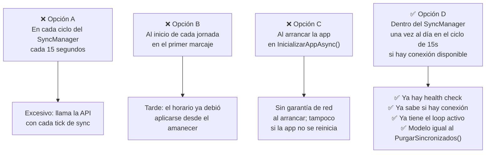
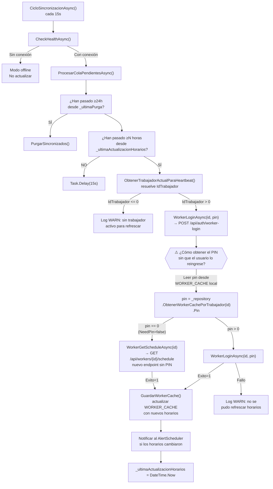
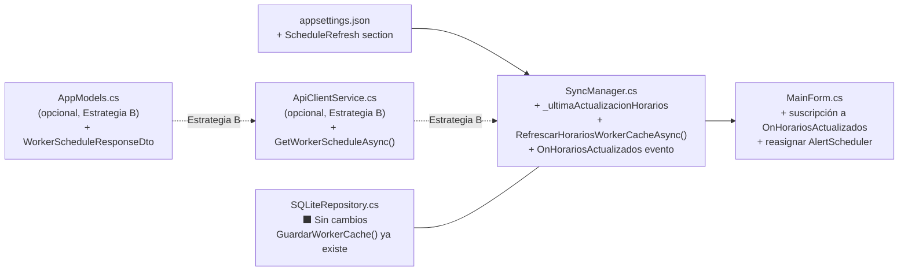

# Propuesta Técnica: Actualización Diaria de Horarios en `WORKER_CACHE`

> [!NOTE]
> Este documento es una **propuesta de diseño** — no implica cambios en el código aún.

---

## 1. El Problema

Los horarios del trabajador (`HoraEntrada`, `HoraSalidaComida`, `HoraEntradaComida`, `HoraSalida`) que usa el `AlertScheduler` para disparar alertas **viven en `WORKER_CACHE`** y provienen originalmente de la API al momento del login o la vinculación.

Si el área de RRHH cambia el horario de un trabajador en el servidor, **la app desktop no se entera hasta que el trabajador vuelva a hacer login online**, lo que puede ser días después (especialmente en modo autónomo `NeedPin=false`, donde el PIN solo se pide una vez en toda la vida del vínculo).

---

## 2. Análisis del Ciclo de Vida — ¿Cuándo actualizar?

### Opciones evaluadas



### ¿Por qué el `SyncManager` es el lugar correcto?

El `SyncManager` ya implementa **exactamente este patrón** para la purga de registros:

```csharp
// SyncManager.cs — patrón existente (referencia)
if ((DateTime.Now - _ultimaPurga).TotalHours >= 24)
{
    int eliminados = _repository.PurgarSincronizados(30);
    _ultimaPurga = DateTime.Now;
}
```

Reutilizar este patrón para la actualización de horarios es **consistente, predecible y no requiere crear nuevas dependencias**.

---

## 3. Diseño de la Solución

### 3.1 Momento de ejecución propuesto

```
Cada ciclo del SyncManager (15s) cuando hayConexion == true:
  └─ Si (DateTime.Now - _ultimaActualizacionHorarios).TotalHours >= HorasCadencia
       └─ RefrescarHorariosWorkerCacheAsync()
```

**Cadencia recomendada: 24 horas**, configurable en `appsettings.json`.

La ventana real de ejecución es: *"La primera vez que el SyncManager detecte conexión y hayan pasado ≥24 h desde la última actualización"*. Esto es correcto: si la máquina no tiene red en ese momento, esperará a la próxima ventana con conectividad.

---

### 3.2 Diagrama de flujo del nuevo proceso



---

### 3.3 El problema del PIN — Dos estrategias

Este es el punto de diseño más crítico. Para llamar `WorkerLoginAsync` se necesita el PIN, pero en el background el usuario no está presente.

#### Estrategia A — Reutilizar el PIN guardado en `WORKER_CACHE` *(recomendada para NeedPin=true)*

El PIN ya está almacenado en `WORKER_CACHE` desde el login anterior. Solo se lee y se reutiliza para llamar al endpoint de login existente.

| Ventaja | Desventaja |
|---|---|
| No requiere endpoint nuevo en la API | El PIN en caché puede estar desactualizado si el usuario lo cambió |
| Funciona con la infraestructura actual | Reutilizar el login como "refresh" es semánticamente incorrecto |
| Bajo riesgo de cambio | Si el PIN cambió, el refresh fallará silenciosamente |

#### Estrategia B — Nuevo endpoint en la API `GET /api/workers/{id}/schedule` *(recomendada para NeedPin=false y a largo plazo)*

Un endpoint dedicado que devuelve solo los horarios del trabajador, autenticado con el `X-Api-Key` de la estación (ya presente en todos los requests).

```json
// Response esperada
{
  "exito": 1,
  "data": {
    "idTrabajador": 42,
    "nombreCompleto": "Juan García",
    "horaEntrada": "08:00",
    "horaSalidaComida": "13:00",
    "horaEntradaComida": "14:00",
    "horaSalida": "17:00"
  }
}
```

| Ventaja | Desventaja |
|---|---|
| No requiere PIN | Requiere cambio en la API del servidor |
| Semánticamente correcto | Más esfuerzo de implementación total |
| Funciona en ambos modos (con/sin PIN) | Necesita coordinación back-end |
| Sin riesgo de autenticación fallida | |

> [!IMPORTANT]
> **Recomendación:** Implementar la **Estrategia A** como solución inmediata (aprovecha infraestructura existente) y la **Estrategia B** como evolución a mediano plazo, especialmente para el modo autónomo donde `Pin=0`.

---

## 4. Cambios necesarios por componente

### 4.1 `appsettings.json` — Nueva configuración

```json
{
  "ScheduleRefresh": {
    "Enabled": true,
    "CadenciaHoras": 24
  }
}
```

Permite controlar si el refresh está activo y la frecuencia sin recompilar.

---

### 4.2 `ApiClientService.cs` — Nuevo método (Estrategia B)

```csharp
// Nuevo método opcional para endpoint dedicado
public async Task<ApiResponseDto<WorkerScheduleResponseDto>?> GetWorkerScheduleAsync(int idTrabajador)
{
    return await GetJsonAsync<WorkerScheduleResponseDto>($"api/workers/{idTrabajador}/schedule");
}
```

Si se elige la Estrategia A, **no se necesita este método** — se reutiliza `WorkerLoginAsync`.

---

### 4.3 `AppModels.cs` — Nuevo DTO (solo Estrategia B)

```csharp
public class WorkerScheduleResponseDto
{
    public int IdTrabajador { get; set; }
    public string NombreCompleto { get; set; } = string.Empty;
    public string? HoraEntrada { get; set; }
    public string? HoraSalidaComida { get; set; }
    public string? HoraEntradaComida { get; set; }
    public string? HoraSalida { get; set; }
}
```

---

### 4.4 `SyncManager.cs` — Cambios principales

Tres adiciones al archivo existente:

**a) Nueva variable de control** (similar a `_ultimaPurga`):
```csharp
private DateTime _ultimaActualizacionHorarios = DateTime.MinValue;
private readonly TimeSpan _cadenciaActualizacionHorarios = TimeSpan.FromHours(24); // o desde config
```

**b) Invocación dentro de `CicloSincronizacionAsync()`** (después del bloque de purga):
```csharp
// Dentro del bloque: if (hayConexion)
if ((DateTime.Now - _ultimaActualizacionHorarios) >= _cadenciaActualizacionHorarios)
{
    await RefrescarHorariosWorkerCacheAsync();
}
```

**c) Nuevo método privado `RefrescarHorariosWorkerCacheAsync()`**:
```csharp
private async Task RefrescarHorariosWorkerCacheAsync()
{
    // 1. Resolver qué trabajador está activo en este equipo
    int idTrabajador = ObtenerTrabajadorActualParaHeartbeat(); // método ya existe
    if (idTrabajador <= 0)
    {
        _repository.RegistrarLog("WARN", "SyncManager.HorarioRefresh",
            "Sin trabajador activo vinculado. Actualización de horarios omitida.");
        return;
    }

    // 2. Obtener el PIN desde la caché local (Estrategia A)
    var cache = _repository.ObtenerWorkerCachePorTrabajador(idTrabajador);
    if (cache == null)
    {
        _repository.RegistrarLog("WARN", "SyncManager.HorarioRefresh",
            $"Sin caché local para trabajador={idTrabajador}. Actualización omitida.");
        return;
    }

    // 3. Llamar a la API
    var resp = await _apiClient.WorkerLoginAsync(idTrabajador, cache.Pin);
    if (resp == null || resp.Exito != 1 || resp.Data == null)
    {
        _repository.RegistrarLog("WARN", "SyncManager.HorarioRefresh",
            $"No se pudo actualizar horarios para trabajador={idTrabajador}. " +
            $"Motivo: {resp?.Mensaje ?? "Sin respuesta de API"}");
        return;
    }

    // 4. Detectar si los horarios cambiaron antes de escribir
    bool cambio =
        cache.HoraEntrada       != resp.Data.HoraEntrada       ||
        cache.HoraSalidaComida  != resp.Data.HoraSalidaComida  ||
        cache.HoraEntradaComida != resp.Data.HoraEntradaComida ||
        cache.HoraSalida        != resp.Data.HoraSalida;

    // 5. Persistir en WORKER_CACHE
    var actualizado = new WorkerCacheItem
    {
        IdTrabajador      = idTrabajador,
        Pin               = cache.Pin,
        NombreCompleto    = resp.Data.NombreCompleto,
        HoraEntrada       = resp.Data.HoraEntrada,
        HoraSalidaComida  = resp.Data.HoraSalidaComida,
        HoraEntradaComida = resp.Data.HoraEntradaComida,
        HoraSalida        = resp.Data.HoraSalida
    };
    _repository.GuardarWorkerCache(actualizado);

    string logMsg = cambio
        ? $"Horarios actualizados para trabajador={idTrabajador}. " +
          $"Entrada={resp.Data.HoraEntrada}, SalidaComida={resp.Data.HoraSalidaComida}, " +
          $"EntradaComida={resp.Data.HoraEntradaComida}, Salida={resp.Data.HoraSalida}"
        : $"Horarios verificados sin cambios para trabajador={idTrabajador}.";

    _repository.RegistrarLog("INFO", "SyncManager.HorarioRefresh", logMsg);

    // 6. Notificar si hubo cambio (para que el AlertScheduler recargue en memoria)
    if (cambio)
    {
        OnHorariosActualizados?.Invoke(this, actualizado);
    }

    _ultimaActualizacionHorarios = DateTime.Now;
}
```

---

### 4.5 `SyncManager.cs` — Nuevo evento público

```csharp
// Nuevo evento para notificar a MainForm cuando los horarios cambian
public event EventHandler<WorkerCacheItem>? OnHorariosActualizados;
```

---

### 4.6 `MainForm.cs` — Suscribirse al evento y recargar el `AlertScheduler`

```csharp
// En ConfigurarEventos()
_syncManager.OnHorariosActualizados += (s, workerActualizado) =>
{
    // Actualizar la referencia en memoria
    _trabajadorCacheActual = workerActualizado;

    // Reasignar al AlertScheduler para que use los nuevos horarios
    _alertScheduler.AsignarTrabajador(workerActualizado);

    _repository.RegistrarLog("INFO", "MainForm",
        $"AlertScheduler actualizado con nuevos horarios de trabajador={workerActualizado.IdTrabajador}");
};
```

> [!IMPORTANT]
> El `AlertScheduler` guarda el `WorkerCacheItem` en su campo `_trabajadorActual`. Basta con llamar `AsignarTrabajador()` para que en el siguiente tick del ciclo de 30s use los horarios nuevos. **No requiere reiniciar el scheduler.**

---

## 5. Casos edge y su manejo

| Caso | Comportamiento propuesto |
|---|---|
| **Sin conexión al momento del refresh** | Se omite silenciosamente. El siguiente ciclo con conexión lo reintentará |
| **PIN cambiado en servidor (login falla)** | Log WARN, `_ultimaActualizacionHorarios` **no se actualiza** para que reintente en el próximo ciclo |
| **Modo autónomo (`NeedPin=false`, `Pin=0`)** | `WorkerLoginAsync(id, 0)` fallará → log WARN. Requiere Estrategia B para cubrirse completamente |
| **La app no se reinicia en días** | El SyncManager sigue corriendo → el refresh ocurrirá automáticamente cada 24h mientras haya red |
| **Horarios cambian a mitad de jornada** | Los horarios del día **en curso** ya se dispararon parcialmente. El cambio tomará efecto en las alertas **aún no disparadas** del mismo día (p.ej. si cambia `HoraSalida` y aún no se ha marcado) |
| **Trabajador sin vínculo activo** | `ObtenerTrabajadorActualParaHeartbeat()` retorna 0 → se omite con log |

---

## 6. Resumen de archivos afectados



> [!TIP]
> Con la **Estrategia A** (reutilizar `WorkerLoginAsync`) los cambios se limitan a **3 archivos**: `appsettings.json`, `SyncManager.cs` y `MainForm.cs`. `SQLiteRepository.cs` no requiere ningún cambio.

---

## 7. Evaluación final de riesgos

| Riesgo | Nivel | Mitigación |
|---|---|---|
| Sobrecarga a la API | 🟢 Bajo | Una sola llamada por equipo cada 24h |
| Interferencia con sync de cola | 🟢 Bajo | Es asíncrono y secuencial dentro del mismo ciclo |
| Horario incorrecto en memoria durante el día | 🟡 Medio | El cambio aplica en las alertas pendientes; las ya disparadas no se revierten |
| Fallo de PIN en modo autónomo | 🔴 Alto (sin Estrategia B) | Mitigado completamente con endpoint dedicado en Estrategia B |
| Escritura concurrente en SQLite | 🟢 Bajo | `SQLiteRepository` crea una conexión nueva por operación (sin estado compartido) |
